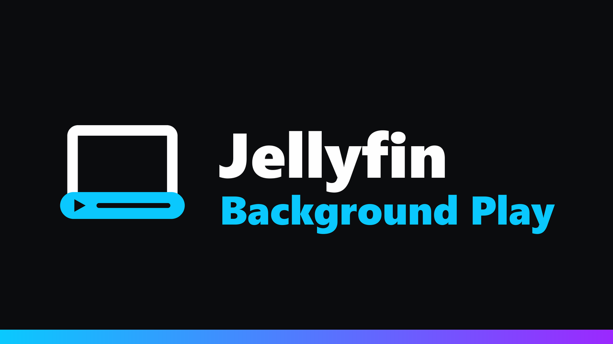
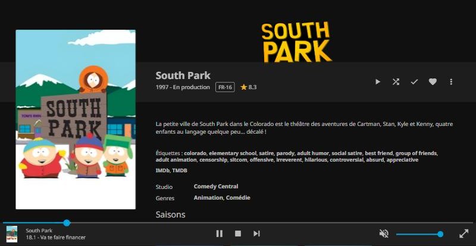
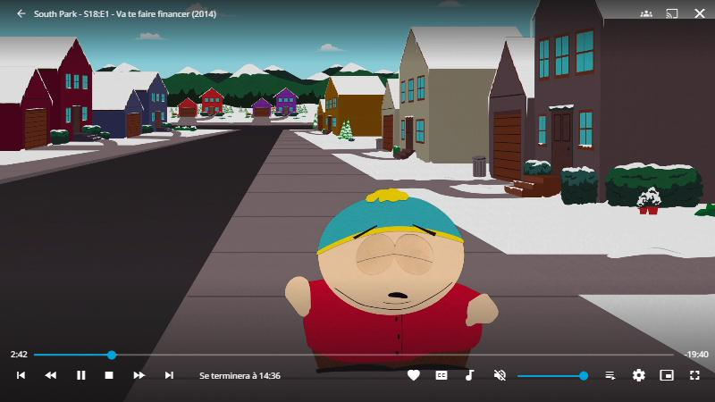

<p align="center">
  
</p>

<p align="center">
  <a href="https://github.com/k1k4k/jellyfin-background-play/releases/latest"></a>
  
  <a href="https://github.com/k1k4k/jellyfin-background-play/releases"></a>
  <a href="LICENSE"></a>
</p>

<p align="center">
  <b>Leaving the player no longer stops the video.</b><br>
  It keeps playing with the music mini player bar while you browse your library.
</p>

<p align="center">
  <a href="#installation">Installation</a> ·
  <a href="#features">Features</a> ·
  <a href="#troubleshooting">Troubleshooting</a> ·
  <a href="README.fr.md">Version française</a>
</p>

<p align="center"></p>

## Features

### When you leave the player

- **The video keeps playing**: back arrow, browser or phone back, a link to another page… playback no longer stops.
- **The same bar as for music** at the bottom of the screen: play / pause, **stop**, previous / next episode, seek, volume. Click the bar (or <code>⤢</code>) to get back to the player, right where the video is.
- **The next episode starts in the background**, without bringing the player back.
- Starting something else (a movie, another series) opens the player as usual; starting music stops the video and hands over to the music bar.

### In the player

- **Stop button** (square) next to pause, and a **close cross at the top right**: to stop the video and leave the player, since the back arrow no longer does.

### Everywhere

- Desktop and mobile: on narrow screens, pause and stop stay available on the right of the bar.
- Works alongside [Jellyfin Player Queue](https://github.com/k1k4k/jellyfin-player-queue).
- English or French, following the browser language.

<p align="center"></p>

## Installation

### Plugin (recommended)

1. **Dashboard → Plugins → Manage Repositories → `+`**, then the k1k4k plugin repository URL matching your Jellyfin:

   | Jellyfin | Repository URL |
   |---|---|
   | 12.x | `https://k1k4k.github.io/jellyfin-plugins/manifest.json` |
   | 10.11.x | `https://k1k4k.github.io/jellyfin-plugins/manifest-10.11.json` |

   This repository lists every k1k4k plugin (Background Play, Player Queue…). If you already added the Player Queue repository, there's nothing to do: Background Play shows up there too.

2. **Plugins → Available → Jellyfin Background Play → Install**, then restart Jellyfin.
3. `Ctrl+F5` in the browser.

The plugin injects the script each time the page loads: no Jellyfin file is modified, and nothing needs redoing after a Jellyfin update, Docker included. New versions show up in the dashboard. The plugin settings page can turn it off without uninstalling.

<details>
<summary><b>Other methods (without the repository, or without a plugin)</b></summary>

#### Plugin, by hand

Download the zip from the [latest release](https://github.com/k1k4k/jellyfin-background-play/releases/latest) (`_jf12` for Jellyfin 12, `_jf10` for 10.11), unzip it into `<config>/plugins/BackgroundPlay/` and restart Jellyfin.

#### JavaScript Injector

If you already use [JavaScript Injector](https://github.com/n00bcodr/Jellyfin-JavaScript-Injector): add a script and paste the contents of [`jellyfin-background-play.js`](jellyfin-background-play.js).

#### Install script

Copies the `.js` into Jellyfin's web folder and adds a `<script>` tag to `index.html` (a backup is made the first time).

> [!WARNING]
> A Jellyfin update replaces `index.html`: run the script again. **With Docker, every image update wipes the install**: use the plugin instead.

```powershell
# Windows
.\install.ps1                                   # auto-detect
.\install.ps1 -WebDir "\\SERVER\jellyfin\web"   # local folder or network share
.\install.ps1 -Uninstall
```

```bash
# Linux
sudo ./install.sh                               # auto-detect
sudo ./install.sh /usr/share/jellyfin/web
```

If `index.html` is read-only but its folder is writable (web folder shared over Samba, file owned by root), `install.ps1` moves the original aside as `index.html.bgplay.orig`; `-Uninstall` restores it.

#### By hand

Copy `jellyfin-background-play.js` next to `index.html` in the web folder, and add right before `</head>`:

```html
<script defer="defer" src="jellyfin-background-play.js"></script>
```

</details>

## Compatibility

| | |
|---|---|
| **Jellyfin 12.x** | tested (12.1.0) |
| **Jellyfin 10.11** | plugin built, untested (the Jellyfin code involved is the same as in 12.1) |
| **Browser** (desktop, mobile) | yes |
| **Apps that show the web UI** (Jellyfin Media Player, Android app) | should work, untested |
| **Native apps** (Android TV, Swiftfin, Findroid…) | no: they don't use the web player |
| **TV mode, Chromecast, remote playback** | Jellyfin's original behavior |

The script doesn't patch Jellyfin: it finds the internal player by its content, so it isn't tied to a specific build.

## Troubleshooting

- **The video still stops when leaving the player**: open the browser console (`F12`). You should see `[BackgroundPlay] v… – playbackManager found, appRouter found`. If it says `playbackManager not found`, your Jellyfin version isn't recognized: [open an issue](https://github.com/k1k4k/jellyfin-background-play/issues) and mention it.
- **Nothing in the console**: the script isn't loaded. Clear the cache (`Ctrl+F5`). With the install script, check the tag in `index.html` and run the install again after each Jellyfin update.
- **The next episode brings the player back**: the console says `appRouter not found`. Open an issue with your Jellyfin version.

<details>
<summary><b>Development</b></summary>

#### Client script

The script is tested on a local test bench, `web-dev/`: a copy of Jellyfin's web interface served from your machine and talking to a real Jellyfin server. The server itself is never modified. The folder isn't in the repository (it's Jellyfin's code, and its config contains your server's address); create it once:

1. Copy Jellyfin's web folder (the one containing `index.html`) into `web-dev/`. It lives in `C:\Program Files\Jellyfin\Server\jellyfin-web` on Windows, `/usr/share/jellyfin/web` on Linux, `/jellyfin/jellyfin-web` in the official Docker image. Use the same Jellyfin version as your server.
2. In `web-dev/config.json`, set `"multiserver": true` and put your server in `"servers"`, e.g. `["http://192.168.1.10:8096"]`.
3. Copy `jellyfin-background-play.js` into `web-dev/`, and in `web-dev/index.html` add right before `</head>`:
   ```html
   <script defer="defer" src="jellyfin-background-play.js"></script>
   ```
4. Serve it, then open `http://localhost:8098` and sign in:
   ```powershell
   python -m http.server 8098 --directory web-dev --bind 127.0.0.1
   ```

After each change to the script, copy it into `web-dev/` again and reload with `Ctrl+F5`. The same `web-dev/` can also serve the other scripts (Player Queue) to test them together.

#### Plugin

`Jellyfin.Plugin.BackgroundPlay/`: one source, two targets, `-p:JellyfinTarget=jf12` (Jellyfin 12, .NET 10, default) and `jf10` (Jellyfin 10.11, .NET 9). `jellyfin-background-play.js` is embedded as is. Without a local SDK:

```bash
docker run --rm -v "$PWD:/src" -w /src mcr.microsoft.com/dotnet/sdk:10.0 dotnet build Jellyfin.Plugin.BackgroundPlay/Jellyfin.Plugin.BackgroundPlay.csproj -c Release -o out/jf12
```

#### Releasing

1. Bump `VERSION` in `jellyfin-background-play.js` and `<Version>` / `<AssemblyVersion>` in the csproj; add a `## X.Y.Z` section to `CHANGELOG.md`.
2. `git tag vX.Y.Z && git push origin vX.Y.Z`: the **Release** workflow builds both targets, publishes the release and updates the manifests on `main`. The central [`jellyfin-plugins`](https://github.com/k1k4k/jellyfin-plugins) repository picks them up on its next run (hourly, or right away with the `PLUGINS_REPO_TOKEN` secret).

</details>

## License

MIT, see [LICENSE](LICENSE).
